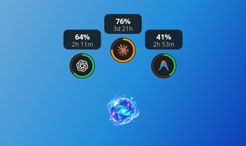
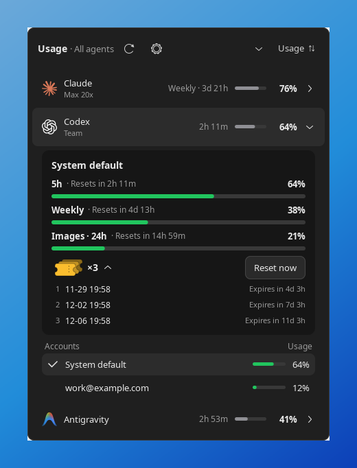

# agent-usage

[English](README.md)

AI 코딩 에이전트의 사용량을 화면에 떠 있는 동그라미로 보여 주는 리눅스 위젯입니다. 각 에이전트의 로컬 로그인 정보를 바로 읽어서 프록시가 필요 없습니다.

**지원 에이전트: 현재 Codex, Claude, Antigravity만 지원합니다.**

| 떠 있는 동그라미 | 사용량 패널 |
|---|---|
|  |  |

## 기능

**공통**

- 항상 위에 떠 있는 에너지 오브가 천천히 돌며 색이 은은하게 바뀝니다. 누르면 에이전트별 동그라미가 부채꼴로 펼쳐지고, 위에 사용률과 초기화까지 남은 시간이 표시됩니다.
- 에이전트 동그라미를 누르면 모든 사용량 한도와 요금제 이름이 담긴 상세 패널이 열립니다.
- 에이전트마다 계정을 여러 개 등록할 수 있습니다. 계정 추가나 다시 로그인을 누르면 브라우저에서 로그인 페이지가 열립니다.
- 상단바에도 에이전트별 사용률이 표시됩니다.
- 기본 5분마다 갱신합니다. 마지막 값을 저장해서 다시 켜도 바로 보여 줍니다. 사용량 API가 요청이 잦다고 거절하면 5분에서 30분까지 쉬면서 마지막 값을 보여 줍니다.
- 설정에서 언어, 사용률/남은 양 표시, 상단바 아이콘, 갱신 주기, 로그인 시 자동 실행, 보여 줄 에이전트를 고를 수 있습니다.
- 값이 바뀌면 이어서 차오르고, 행은 미끄러지듯 펼쳐집니다.

**Codex**

- 5시간·주간 한도와, 계정에 있으면 모델별 추가 한도.
- 리셋권: 남은 장수, 장마다 만료일, *지금 재설정*. **지금 재설정은 리셋권을 실제로 1회 씁니다.** 누르면 확인 창이 먼저 뜨고 기본 선택은 취소입니다.
- 이미지 생성 24시간 한도.

**Claude**

- 5시간·주간 한도.
- Opus, Sonnet 같은 모델별 주간 한도.

**Antigravity**

- 모델 그룹별 5시간·주간 한도.

## 설치

Ubuntu 24.04 GNOME X11에서 확인했습니다.

```bash
curl -fsSL https://raw.githubusercontent.com/Changroro/agent-usage/main/install.sh | bash
```

필요한 시스템 패키지를 설치하고(없는 게 있으면 sudo 비밀번호를 묻습니다), 위젯을 `~/.local/share/agent-usage`에 넣고, `agent-usage` 명령과 앱 메뉴 항목을 만듭니다. 같은 줄을 다시 실행하면 업데이트됩니다. 지우려면 `bash` 뒤에 `-s -- --uninstall`을 붙입니다.

그다음 쓰는 에이전트에 각 CLI로 로그인하고(`codex login`, `claude`, `agy`) `agent-usage`를 실행합니다. 계속 켜 두려면 설정에서 *로그인 시 자동 실행*을 켭니다.

## 사용법

| 조작 | 결과 |
|---|---|
| 동그라미 누르기 | 에이전트 동그라미가 부채꼴로 펼쳐짐, 다시 누르면 접힘 |
| 동그라미 끌기 | 위치 이동. 부채꼴과 열린 패널이 따라오고 위치는 저장됨 |
| 에이전트 동그라미 누르기 | 그 에이전트 상세 패널 |
| 동그라미 오른쪽 클릭 | 전체 보기, 설정, 새로고침, 종료 |
| 패널의 톱니바퀴 | 설정: 표시, 갱신 주기, 자동 실행, 에이전트와 계정 |

`agent-usage --open`으로 실행하면 패널도 바로 열립니다. 언어는 시스템 언어를 따르고 `AGENT_USAGE_LANGUAGE=ko` 또는 `en`으로 바꿀 수 있습니다.

## 데이터를 읽는 곳

| 에이전트 | 계정 | 사용량 |
|---|---|---|
| Codex | `~/.codex`, 여기서 추가한 계정(`CODEX_HOME`) | `wham/usage`, 리셋권 API, 이미지 한도 헤더 |
| Claude | `~/.claude`, 여기서 추가한 계정(`CLAUDE_CONFIG_DIR`) | `api/oauth/usage` |
| Antigravity | 시스템 키링 계정, 여기서 추가한 계정(별도 `HOME`, 파일 토큰 저장) | `agy -p /usage` |

토큰은 각 에이전트의 공식 API로만 보냅니다. 위젯은 토큰을 직접 갱신하지 않고 각 CLI에 맡깁니다. 추가한 계정과 동그라미 위치는 `~/.config/agent-usage/`에 저장됩니다.

이미지 한도는 빈 프롬프트로 이미지 생성을 요청해서 받은 거절 응답의 헤더로 읽습니다. 서버가 거절하므로 이미지는 만들어지지 않습니다.

## 개발

```bash
python3 -m unittest discover -s tests
AGENT_USAGE_LANGUAGE=en ./scripts/screenshots.py   # README 스크린샷을 예시 데이터로 다시 생성
```

에이전트 아이콘은 [LobeHub Icons](https://github.com/lobehub/lobe-icons)(MIT, `assets/LobeHub-LICENSE`)에서 가져왔습니다. 오브 그림(`assets/orb.png`)은 이 프로젝트용으로 Codex의 OpenAI 이미지 생성으로 만들었습니다.

## 라이선스

MIT
