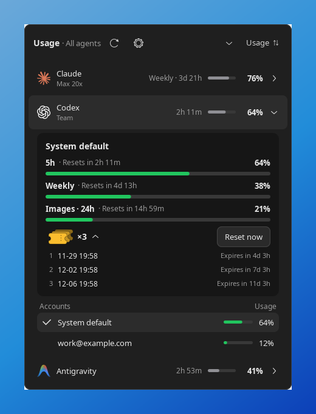

# agent-usage

[한국어](README.ko.md)

A floating desktop widget for Linux that shows how much of your AI coding agent quotas you have used. It reads each agent's own local sign-in, so no proxy is needed.

**Supported agents: Codex, Claude and Antigravity only.**

| Floating bubble | Usage panel |
|---|---|
|  |  |

## Features

**All agents**

- A floating energy orb that stays on top, slowly turning while its colors drift. Click it to fan out one bubble per agent with its usage and time to reset.
- Click an agent bubble for its detail panel with every usage window and the plan name.
- Several accounts per agent. Add or sign in again from the panel, and the sign-in page opens in your browser.
- Top bar indicators with the current usage of each agent.
- Polls every 5 minutes by default. The last values are cached, so they show right away after a restart. When a usage API rate-limits you, the widget waits 5 to 30 minutes and keeps showing the last value.
- Optional desktop alerts, off by default: when a limit crosses the threshold you set with a slider (50–100%), when it runs out, and when it resets. Each alert fires once per limit until it resets.
- Settings for language, used or remaining display, top bar icons, refresh interval, start on login, alerts and which agents to show.
- Values fill in smoothly when they change, and rows slide open.

**Codex**

- 5-hour and weekly limits, plus any extra per-model limits on the account.
- Rate limit reset credits: the count, each ticket's expiry date, and *Reset now*. **Reset now uses a real credit**, so it asks first with Cancel as the default.
- The 24-hour image generation limit.

**Claude**

- 5-hour and weekly limits.
- Per-model weekly limits such as Opus or Sonnet.

**Antigravity**

- 5-hour and weekly limits for each model group.

## Installation

Tested on Ubuntu 24.04 with GNOME on X11.

```bash
curl -fsSL https://raw.githubusercontent.com/Changroro/agent-usage/main/install.sh | bash
```

This installs the system packages it needs (asks for your sudo password if any are missing), puts the widget in `~/.local/share/agent-usage`, and adds the `agent-usage` command and an app menu entry. Run the same line again to update. Add `-s -- --uninstall` after `bash` to remove it.

Then sign in to the agents you use with their own CLI (`codex login`, `claude`, `agy`) and run `agent-usage`. Turn on *Start on login* in the settings to keep it running.

## Usage

| Action | Result |
|---|---|
| Click the bubble | Fan out the agent bubbles, click again to fold |
| Drag the bubble | Move it. The fan and the open panel follow, and the position is remembered |
| Click an agent bubble | Open that agent's detail panel |
| Right-click the bubble | Show all, settings, refresh, quit |
| Gear icon in the panel | Settings: display, refresh interval, start on login, agents and accounts |

`agent-usage --open` also opens the panel right away. The language follows the system, and `AGENT_USAGE_LANGUAGE=ko` or `en` overrides it.

## Where the data comes from

| Agent | Accounts | Usage |
|---|---|---|
| Codex | `~/.codex`, accounts added here (`CODEX_HOME`) | `wham/usage`, reset credit API, image limit headers |
| Claude | `~/.claude`, accounts added here (`CLAUDE_CONFIG_DIR`) | `api/oauth/usage` |
| Antigravity | the system keyring account, accounts added here (separate `HOME`, file token storage) | `agy -p /usage` |

Tokens are only sent to each agent's own API. The widget never refreshes tokens itself and leaves that to each CLI. Added accounts and the bubble position are stored in `~/.config/agent-usage/`.

The image limit is read from the headers of an image request with an empty prompt. The server rejects it, so no image is generated.

## Development

```bash
python3 -m unittest discover -s tests
AGENT_USAGE_LANGUAGE=en ./scripts/screenshots.py   # regenerate the README screenshots from sample data
```

Agent icons come from [LobeHub Icons](https://github.com/lobehub/lobe-icons) (MIT, `assets/LobeHub-LICENSE`). The orb image (`assets/orb.png`) was made for this project with OpenAI image generation through Codex.

## License

MIT
