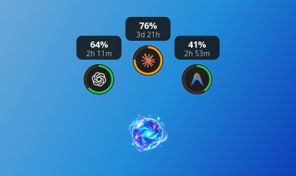

# agent-usage

[한국어](README.ko.md)

A floating desktop widget for Linux that shows how much of your AI coding agent quotas you have used. It reads each agent's own local sign-in, so no proxy is needed.

**Supported agents: Codex, Claude and Antigravity only.**

| Floating bubble | Usage panel |
|---|---|
|  |  |

## Features

- A floating bubble that stays on top. Click it to fan out one bubble per agent with its usage and time to reset.
- Click an agent bubble for its detail panel: 5-hour, weekly and per-model windows.
- Codex extras: rate limit reset credits (click the tickets for each expiry date) and the 24-hour image generation limit.
- Several accounts per agent. Add or sign in again from the panel, and the sign-in page opens in your browser.
- Top bar indicators with the current usage of each agent.
- Polls every 5 minutes. When an agent's usage API rate-limits you, the widget waits 5 to 30 minutes and keeps showing the last value.

## Installation

Tested on Ubuntu 24.04 with GNOME on X11.

**1. Install the system packages**

```bash
sudo apt install python3-gi python3-gi-cairo gir1.2-ayatanaappindicator3-0.1 gnome-shell-extension-appindicator
```

**2. Get the widget**

```bash
git clone https://github.com/Changroro/agent-usage.git
cd agent-usage
```

**3. Sign in to the agents you use**

The widget reads the sign-in of each agent's own CLI. Sign in once with `codex login`, `claude` or `agy`. You can add more accounts later from the widget.

**4. Run**

```bash
./bin/agent-usage
```

**5. Start on login (optional)**

Run this inside the `agent-usage` folder.

```bash
mkdir -p ~/.config/autostart
printf '[Desktop Entry]\nType=Application\nName=agent-usage\nExec=%s/bin/agent-usage\n' "$PWD" > ~/.config/autostart/agent-usage.desktop
```

## Usage

| Action | Result |
|---|---|
| Click the bubble | Fan out the agent bubbles, click again to fold |
| Drag the bubble | Move it. The fan and the open panel follow, and the position is remembered |
| Click an agent bubble | Open that agent's detail panel |
| Right-click the bubble | Show all, connect accounts, refresh, quit |
| Gear icon in the panel | Add, rename, sign in again or remove accounts |

`./bin/agent-usage --open` also opens the panel right away. The language follows the system, and `AGENT_USAGE_LANGUAGE=ko` or `en` overrides it.

## Where the data comes from

| Agent | Accounts | Usage |
|---|---|---|
| Codex | `~/.codex`, [Orca](https://github.com/stablyai/orca) accounts, accounts added here (`CODEX_HOME`) | `wham/usage`, reset credit API, image limit headers |
| Claude | `~/.claude`, accounts added here (`CLAUDE_CONFIG_DIR`) | `api/oauth/usage` |
| Antigravity | the system keyring account, accounts added here (separate `HOME`, file token storage) | `agy -p /usage` |

Tokens are only sent to each agent's own API. The widget never refreshes tokens itself and leaves that to each CLI. Added accounts and the bubble position are stored in `~/.config/agent-usage/`.

The image limit is read from the headers of an image request with an empty prompt. The server rejects it, so no image is generated.

**Reset now uses a real Codex reset credit.** It asks for confirmation first, with Cancel as the default.

## Development

```bash
python3 -m unittest discover -s tests
AGENT_USAGE_LANGUAGE=en ./scripts/screenshots.py   # regenerate the README screenshots from sample data
```

Icons come from [LobeHub Icons](https://github.com/lobehub/lobe-icons) (MIT, `assets/LobeHub-LICENSE`).

## License

MIT
